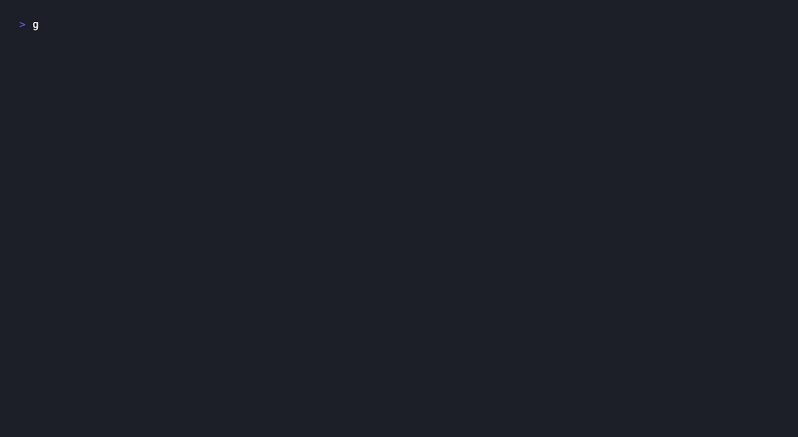

**English** | [简体中文](./README.md)

<div align="center">

<picture>
  <source media="(prefers-color-scheme: dark)" srcset="./assets/hero-dark.svg">
  
</picture>

**The assumption ledger for coding-agent edits, built for reviewers**

Preledger records the unverified assumptions behind every coding-agent edit into a ledger that travels with the repo; reviewers confirm or refute each entry in a local UI, and every refuted assumption compiles into a failing test.

[](https://github.com/SuperMarioYL/preledger/actions/workflows/ci.yml)
[](https://github.com/SuperMarioYL/preledger/releases)
[](https://go.dev)
[](./LICENSE)


**Free and open source — nothing paywalled in v0.1.**

</div>

## Why

When you merge an AI-written diff, you can see what changed but not what it took for granted. Session transcripts record actions and after-the-fact completion claims ("I fixed X"), never the premise behind each edit: does that config file actually exist? Is that dependency actually declared in go.mod? The PR description is written after the work, by the same agent that wants the merge — it will only ever say what was done.

Preledger makes premises first-class objects and records them **at the moment the edit happens**:

- **Capture never interrupts the edit.** `preledger install` wires a PostToolUse hook into Claude Code once; after that the agent keeps working as usual, and every Edit/Write is recorded.
- **The ledger travels with the repo.** `.preledger/ledger.jsonl` is a plain append-only JSONL file; each record carries the edit reference (session, tool_use, file, diff hunk) plus the verbatim quote that triggered it. No daemon, no database, no cloud.
- **Refutations compile into tests.** The reviewer clicks 证伪 (refute) and Preledger writes a test asserting that premise into the repo — a genuinely false premise turns the suite red, and fixing the code turns it green. Red is the evidence; green is the loop closed.

Capture is heuristic-first and fully offline: the rules look for premises an edit makes about the repo that the tree cannot already answer, rather than guessing intent. LLM triage is optional; everything works with it off.

## Demo

The full loop in about thirty seconds: wire the hook → three edits recorded automatically → refute one entry in the local UI → the suite goes red → fix turns it green.

<p align="center">
  
</p>

The GIF is a real recording (`vhs docs/demo.tape`). The sample repo is generated on the spot by `examples/demo/setup.sh`; to reproduce agent edits in a recording, their hook payloads — byte-for-byte the structure Claude Code writes to hook stdin — are piped straight into `preledger hook`. The exact commands and outputs of each run live in [`docs/demo-results.json`](./docs/demo-results.json).

## Quickstart

You need Go 1.24+ and a repo where you use Claude Code. About one minute.

```bash
# 1. Install the single binary
go install github.com/SuperMarioYL/preledger@latest

# 2. Wire the hook from the repo root (writes .claude/settings.json, scaffolds .preledger/)
cd your-repo
preledger install

# 3. Let Claude Code edit as usual — assumptions land in .preledger/ledger.jsonl

# 4. Review
preledger up          # opens http://127.0.0.1:7830 in your browser
```

In the review UI: filter by status, read each assumption with the verbatim transcript quote behind it, then click **确认** (confirm) or **证伪** (refute). Refuting immediately writes a test into the repo (a Go repo gets `preledger_refute_<id>_test.go`, a package.json repo gets a vitest test), then:

```bash
go test ./...         # a refuted premise that is genuinely false → the suite goes red
# fix the code (or have the agent do it), run again → green
```

**Want to try it without Claude Code first?** The sample input ships with the repo:

```bash
git clone https://github.com/SuperMarioYL/preledger && cd preledger
go build -o bin/preledger .
bash examples/demo/setup.sh          # generates the demo repo and three hook payloads
```

Follow the script's output — it mirrors the quickstart above exactly.

## How it works

<p align="center">
  <picture>
    <source media="(prefers-color-scheme: dark)" srcset="./assets/architecture-dark.svg">
    
  </picture>
</p>

One binary, three subcommands:

| Command | Lifetime | Responsibility |
| --- | --- | --- |
| `preledger install` | once | Writes the PostToolUse hook into `.claude/settings.json`, scaffolds `.preledger/` |
| `preledger hook` | one child process per edit | Reads the stdin payload, parses the transcript, extracts assumptions, appends the ledger; exits 0 even on failure so edits are never blocked |
| `preledger up` | the only long-lived process | The local review UI (127.0.0.1:7830), fsnotify live updates, refutations written back into the repo |

<p align="center">
  <picture>
    <source media="(prefers-color-scheme: dark)" srcset="./assets/process-dark.svg">
    
  </picture>
</p>

### What gets captured

Every edit produces one **mechanical premise** (an Edit assumes the replaced snippet exists and is unique; a Write assumes the file is rewritten wholesale). On top of that, heuristics look for three kinds of premises an edit makes that the repo cannot already answer:

| Heuristic | Trigger | Recorded as |
| --- | --- | --- |
| New dependency | The edited text imports a module the manifest (go.mod / package.json) does not declare | `go.mod 存在且含 <module>` |
| Missing config / env key | The edited text reads a config file absent from the repo; a referenced key cannot be found in the tree | `config.yaml 存在且含 server.port`, `.env 存在且含 <KEY>` |
| Path absent from the repo | A Write lands on a path git reports as new | `<path> 存在` |

The basis prefers the agent's own words spoken before the edit (from the transcript), falling back to the code line that triggered the rule — both are verbatim transcript text, not reconstruction. Entries are keyed by `hash(edit ref + premise)`, so re-capturing the same edit never duplicates records. A real captured record:

```json
{"id":"d0cb1f3e9e449e41","edit_ref":{"session_id":"s1-demo-session","transcript_path":"…/transcript-s1.jsonl","tool_use_id":"toolu_a1","tool":"Edit","file":"main.go","hunk":"@@ -1,7 +1,22 @@"},"statement":"config.yaml 存在且含 server.port","basis":"配置文件还不存在，我会假定 config.yaml 存在且含 server.port，先写读取逻辑。","status":"open"}
```

Confirming or refuting appends a new record — the file stays append-only and diffs cleanly in git.

### Refutation compilation

A refuted premise compiles into an assertion by its grammar; premises without a mechanical check compile into a TODO stub (`t.Skip` / `it.todo`) that keeps the premise as a comment:

| Premise statement | Generated assertion |
| --- | --- |
| `<path> 存在` (exists) | `os.Stat(path)` / `existsSync(path)` |
| `<path> 存在且含 <key>` (exists and contains) | Reads the file and checks for the literal substring (「含」 is a literal match) |
| `<file> 的现有内容中待替换片段存在且唯一：<snippet>` | `strings.Count(data, snippet) == 1` |
| `<file> 的现有内容包含待替换片段：<snippet>` | `strings.Contains(data, snippet)` |

## How it fits alongside existing tools

Preledger does not replace anything in your flow; it fills the one slot nobody owns — the premise:

| Stage | Answers | When |
| --- | --- | --- |
| Agent-written PR description | What was done | After the work |
| Session replay / claim verification | Whether "I fixed it" was true | After the session |
| PR review bots | Generic comments on the diff | After the push |
| **Preledger** | **What this edit took for granted** | **At the moment of the edit** |

<p align="center">
  <picture>
    <source media="(prefers-color-scheme: dark)" srcset="./assets/integrations-dark.svg">
    
  </picture>
</p>

## Configuration

Everything is optional; the defaults run with zero configuration:

| Environment variable | Default | Meaning |
| --- | --- | --- |
| `PRELEDGER_PORT` | `7830` | Review UI port (`up --port` overrides) |
| `PRELEDGER_TRIAGE_PROVIDER` | unset (offline) | `deepseek` or `glm` — enables the optional LLM triage |
| `PRELEDGER_TRIAGE_API_KEY` | unset | API key for the chosen provider (DeepSeek / Zhipu open platform; both are OpenAI-compatible endpoints, no OpenAI key needed) |
| `PRELEDGER_NO_OPEN` | unset | Set to any value and `up` will not open a browser |

The LLM triage does exactly one thing: it asks the model which heuristic candidates are load-bearing and drops the obviously trivial ones. On failure, timeout (5 s) or missing configuration it keeps every candidate — the offline heuristics always work.

## Roadmap

**v0.1 (shipped)**

- PostToolUse capture + three heuristic premise families + optional DeepSeek/GLM triage
- Local Chinese review UI: status filters, per-entry confirm / refute, live updates
- Refutation compilation: Go repos → `go test`, package.json repos → vitest; non-checkable premises → TODO stub

**Next (ordered by feedback)**

- More heuristic patterns (function-signature changes, skipped existing tests)
- Jump straight from a ledger entry to the diff hunk and file
- Publish the ledger format as a standalone spec with a JSON Schema
- Directory-level placement strategy for vitest repos

The boundaries are equally explicit: v0.1 supports Claude Code's hook and transcript format only — no IDE extensions, no PR bots, no hosted service, no auto-fixing.

## Development

```bash
git clone https://github.com/SuperMarioYL/preledger && cd preledger
go build ./... && go vet ./... && go test ./... -count=1
```

`docs/demo-results.json` is the recorded real run of the demo flow; `docs/demo.tape` re-renders `assets/demo.gif` with [vhs](https://github.com/charmbracelet/vhs).

## License

MIT © 2026 SuperMarioYL
